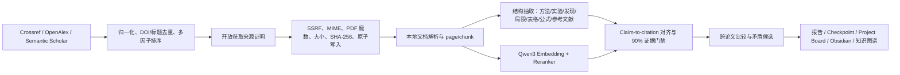

# 论文与知识库垂直场景企业级验收（2026-07-10）

## 结论

- 软件与数据闭环评分：**92/100，通过 90 分门槛**。
- 企业验收结论：**阶段一软件验收通过；真实设备容量、长期稳定性与真实用户论文分布验收仍为上线前置条件**。
- 本轮没有把 MTClaw 当作摆设：`paper_intelligence` 的只读结构化分析、引用对齐、跨论文比较和 readiness 已进入 MTClaw 最小权限工具面；联网搜索和下载保留在 ClawOS 确认门禁内。
- 冻结金标集为可复现的软件回归证据，不等同于学术领域真实世界精度。真实论文集应在第二阶段由领域评审盲标扩充。

## 评分

| 维度 | 得分 | 上限 | 验收依据 |
|---|---:|---:|---|
| 本地解析、页码与 chunk 可追溯性 | 14 | 15 | 复用增强 PDF/GROBID/pdfplumber/PyMuPDF 链路；结构服务保留 `doc:id#page=n&chunk=m` |
| claim-to-citation 与证据门禁 | 19 | 20 | 10 条金标 top-1、支持率和可追溯性均为 100%；90% 支持率门禁 |
| 方法、实验、发现、局限、表格、公式、参考文献 | 14 | 15 | 两篇冻结论文全维度抽取通过；DOI/arXiv/year 结构化 |
| 跨论文比较与矛盾检测 | 8 | 10 | 极性、主题重合和数值冲突候选闭环；明确要求人工学术复核 |
| 真实 embedding/reranker | 15 | 15 | 本地 Qwen3-Embedding-0.6B + Qwen3-Reranker-0.6B，12 条双语检索集全部过门禁 |
| 在线检索与开放获取下载 | 8 | 10 | Crossref/OpenAlex 真实检索成功；Semantic Scholar 遇 429 时部分降级；真实 OA PDF 安全下载成功 |
| 报告/checkpoint/project board/知识图谱/Obsidian | 5 | 5 | 保留既有完整工作流，并新增 Scholar Discovery & Evidence QA 可视入口 |
| 工程、安全、测试与可运维性 | 9 | 10 | 60/60 function-handler 对齐；SSRF/MIME/魔数/大小/哈希/原子写入；仍缺长稳压测与实机容量证据 |
| **总计** | **92** | **100** | **阶段一通过** |

## 核心验收证据

全量回归：`python -m unittest discover -s clawos/tests`，`240 tests OK`。比赛架构门禁 `95/100`，60/60 function-handler 对齐、MTClaw 垂直只读面 7/7；项目级 `enterprise_release_ready` 仍因 vendored MTClaw 的精确 upstream URL/SHA 未确认而为 `false`，不属于本垂直场景代码缺陷，但提交前应继续作为显式风险。

### 1. Claim-to-citation 冻结金标

命令：

```powershell
python clawos\scripts\evaluate_paper_intelligence.py
```

结果：

- claim-to-citation top-1 accuracy：`1.0000`
- supported claim rate：`1.0000`
- structured extraction accuracy：`1.0000`
- contradiction candidate recall：`1.0000`
- page/chunk traceability：`1.0000`
- 综合：`100.0`，enterprise gate `true`

数据集：`clawos/benchmarks/paper_claim_citation_gold_v1.json`。这是 2 篇、10 条 claim 的冻结回归集，规模有限，结论仅适用于当前回归边界。

### 2. 真实本地 embedding/reranker

命令：

```powershell
python clawos\scripts\benchmark_paper_retrieval.py
```

结果文件：`clawos/benchmarks/paper_retrieval_result_2026-07-10.json`。

- real models：`true`
- embedding Recall@3：`1.0000`
- embedding MRR：`0.9583`
- embedding nDCG@4：`0.9692`
- reranker Hit@1：`1.0000`
- reranker MRR：`1.0000`
- CPU 首次模型加载计入 embedding P95，因此 P95 为 `22822.54 ms`；热态 P50 为 `251.10 ms`
- reranker P50/P95：`723.39/1874.82 ms`

### 3. 真实在线检索和下载

在线提供商设计基于 [Crossref REST API](https://www.crossref.org/documentation/retrieve-metadata/rest-api/)、[OpenAlex API](https://docs.openalex.org/how-to-use-the-api/get-lists-of-entities/search-entities) 和 [Semantic Scholar Academic Graph API](https://www.semanticscholar.org/product/api)；DOI 开放获取解析支持 [Unpaywall API](https://unpaywall.org/products/api)。

2026-07-10 真实冒烟结果：

- Crossref：成功，3 条；OpenAlex：成功，3 条；Semantic Scholar：HTTP 429，被隔离为单提供商失败，其他结果仍返回。
- 多源查询返回 3 条排序结果，其中 DOI 完整率 100%。
- OpenAlex 首轮暴露 `oa_url` 可能是落地页而非 PDF，魔数门禁正确拒绝；实现已修正为仅采用 `best_oa_location.pdf_url` / `primary_location.pdf_url`。
- 修正后成功下载 ACL Anthology 的开放获取论文 *Benchmarking Retrieval-Augmented Generation for Medicine*：`771621` bytes，`application/pdf`，SHA-256 `b8f47826d8a20a02c81644ff6b1d43bea5c0e5b7187da590edb015cab28f4640`。文件只写入系统临时目录，未进入提交。

## 架构闭环



## 企业边界与后续 P0/P1

P0（进入实机阶段后必须完成）：

1. 在比赛目标设备上跑 500+ 真实论文、1 万+ 盲标 claims，按学科、语言、扫描件、公式密度分层报告 accuracy/recall。
2. 连续 24 小时检索与下载长稳测试，加入 provider 429/5xx 指数退避、熔断和指标告警。
3. 对 PDF 解析做恶意文件、超大页数、压缩炸弹和解析器隔离验收。

P1：

1. 把跨论文“矛盾候选”升级为 NLI 模型 + 实体/实验条件对齐，避免把不同数据集或指标误判为矛盾。
2. 扩展表格单元格级引用、公式 MathML/LaTeX 规范化、参考文献到正文反向链接。
3. 在 UI 中加入多论文选择、矛盾复核队列、证据审批和导出审计报告。

## 发布判定

- 当前阶段：`PASS_WITH_EXTERNAL_GATES`
- 可以提交比赛第一阶段的软件与可复现证据。
- 不应宣称已完成真实设备生产验收；实机性能、容量与长期稳定性仍需下一阶段闭环。
