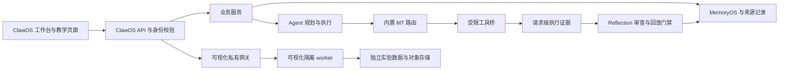

# ClawOS 架构

一个产品仓库、一个ClawOS身份与治理入口。MT路由与Vision能力均为内部模块，源码不再依赖根目录的外置框架副本。

## 源码边界

| 路径 | 职责 |
|---|---|
| `clawos/clawos_server.py`、`api/` | HTTP入口、生命周期及API路由 |
| `clawos/services/` | 教育、文献、协作、编码、数据处理等业务服务 |
| `clawos/memoryos/` | MemoryOS、SQLite持久化与来源/版本记录 |
| `clawos/mtclaw/router/` | 归并后的MT Function Router实现 |
| `clawos/mtclaw/` | Adapter、安全工具桥、运行配置生成及上游许可 |
| `clawos/visualization/backend/` | 可视化、实验、数据集、3D和评估领域服务 |
| `clawos/visualization/worker.py` | ClawOS拥有的私有回环worker入口 |
| `clawos/web/` | 统一React前端源码、依赖锁与前端测试 |
| `clawos/static/` | 现有服务端页面与构建发布资源 |
| `desktop/` | 同一应用的桌面壳与打包 |

可视化后端使用 `visualization.backend.*` 导入，避免通用名称 `server`、`security`、`database` 污染主应用模块。独立进程用于资源、依赖和生命周期隔离，不代表第二套产品入口。原SDK的 `clawvision` Python导入名及现有API、数据目录保留兼容。

## 运行约束

- 默认工作台18790、内部路由18791。路由请求和Tool History绑定会话及请求编号，缺少证据不能认领成功。
- 实验worker按需启动，私有握手通过管道传入。主进程不自动加载模型，也不向worker传递主应用模型密钥或用户数据库配置。
- 文档协作者权限不自动提升为实验/训练所有者权限。真实租户与团队SSO仍有独立验收边界。
- Reflection产生候选，不自动发布运行策略；Skill和策略晋升仍经过回放、回归、影子及灰度门禁。学习自述不计作策略收益。
- 现有数据库、导入回执和模型目录不随源码重排迁移；产品数据迁移必须使用专门迁移工具和回执。

主服务和存储层仍有大型单文件。目录归并不是依赖解耦完成，后续拆分顺序见[维护性评估](MAINTAINABILITY.md)。
